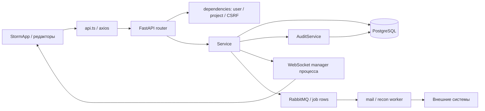

# Поддержка и развитие STORM

Документ описывает код на 16 ноября 2026 года. Начните с этого руководства, затем используйте [каталог методов](METHODS.md), [HTTP-контракты](API_REFERENCE.md) и [схемы полей](API_SCHEMAS.md). Измеренные ограничения перечислены в [архитектурном ревью](ARCHITECTURE_REVIEW.md), защитные границы и требования к обновлению — в [аудите безопасности](SECURITY_AUDIT.md).

Обработка пользовательских ошибок, SMTP и технические логи описаны в [ERRORS_AND_LOGGING.md](ERRORS_AND_LOGGING.md). Итог очистки дублей и старых методов — в [MAINTENANCE_AUDIT.md](MAINTENANCE_AUDIT.md).

## Запуск и проверка

Из корня репозитория, с заполненным локальным `.env`:

```bash
docker compose up -d db minio rabbitmq backend frontend nginx
```

Интерфейс: `https://localhost:3000` или `https://localhost`. Swagger пользовательского API: `/api/v1/docs`, агентского: `/api/v2/docs`; оба требуют авторизации. Healthcheck: `/health` на backend. HTTPS нужен для secure cookie. При проблемах входа проверьте согласованность адреса браузера с `BACKEND_CORS_ORIGINS`, `CSRF_ALLOWED_ORIGINS` и cookie-настройками.

`mail-worker` и `recon-worker` запускаются отдельно, когда нужны почта и сетевые сканы. Для правки интерфейса и внутренних HTTP-тестов они не нужны. `backend/scripts/reset_and_seed.py` изменяет данные; не используйте его как способ запуска или тестирования существующего стенда.

```bash
docker compose exec -T \
  -e STORM_TEST_DATABASE_URL=postgresql+asyncpg://user:password@db:5432/storm \
  backend python -m pytest -q --tb=short

cd frontend
npm test -- --reporter=dot
npm run build
```

Указанный DSN относится к локальному compose. HTTP-тесты создают отдельные схемы `test_<uuid>` и удаляют только их; без явного `STORM_TEST_DATABASE_URL` эти тесты пропускаются. Они не запускают startup приложения, SMTP, SSO, Works, MinIO или сетевые сканы. Для traceback вместо ответа 500 добавьте `-e STORM_TEST_RAISE=1`. Подробности: [QA-аудит](QA_AUDIT.md).

Для наполнения локального интерфейса: `docker compose exec -T backend python -m scripts.seed_ui_demo`. Скрипт добавляет проект `[DEMO] Полный интерфейс` и примеры всех основных сущностей, включая настоящие PNG/evidence в локальном MinIO. Существующие записи не сбрасывает, пароли не меняет, повторный запуск не дублирует проект. Показательные задания фермы терминальные; сканирование и отправка почты не запускаются. Старые архивные таблицы интеграции не наполняются.

## Уведомления и Task Tracker

`notification_events.py` обрабатывает новые упоминания при создании/редактировании заметок, комментариев, текстов находки, заметок хоста и описания эндпоинта. Поддерживает `@username`, `@Фамилия Имя`, `@{Фамилия Имя}`. Получатели — активные незаблокированные участники проекта и администраторы; автор себя не уведомляет. При редактировании уведомляются только добавленные теги. Запись уведомления входит в транзакцию сущности; WebSocket отправляется после commit.

Фоновая задача приложения проверяет дедлайны раз в минуту: дата окончания от сегодня до двух дней включительно, календарь UTC; completed/archived исключены. Получатели — активные незаблокированные участники. Уникальный `dedupe_key` предотвращает повторы при рестартах и одновременных проверках; изменение даты создаёт новый ключ. Миграция 0022 добавляет тип `project_deadline`, JSON `context_data` и индекс ключа. Это in-app уведомления, почта не требуется.

`notificationUpdates.ts` обновляет колокольчик по личному WebSocket, при фокусе окна и раз в 30 секунд как резерв. WS-реестр остаётся локальным процессу, поэтому резерв важен при нескольких workers. Контекст эндпоинта открывает запрос в соответствующем проекте.

Экспорт уязвимостей идёт в STS, Tasks и тикет проекта — в APPSEC. Конфигурация, контракты, тесты и ограничения описаны в [TASK_TRACKER.md](TASK_TRACKER.md). Старые таблицы сохранены миграцией 0023 как архив, старых роутов и клиента в приложении нет.

APPSEC-тикет необязателен при создании и редактировании проекта, привязку можно очистить. Для экспорта в STS обязательны тикет, логин исполнителя и хотя бы одна версия проекта. Сервер возвращает 422 со всеми недостающими полями до сетевых операций; интерфейс показывает этот список в уведомлении снизу справа. Не обходите `normalize_project_ticket` при обработке непустых ключей/URL. Обычная форма нового проекта сбрасывает черновик, включая данные, ранее полученные из Tasks.

Метаданные AS21 читаются из того же unit JSON, что и карточка (`TaskTrackerService.get_task` → `task_out`). `tracker_metadata.py` отделяет логин исполнителя от ФИО и разбирает весь `affects_version_s_crpv`. «Создать проект» из Tasks догружает полную карточку перед открытием формы. Каноническое хранение версий — массив `Project.appsec_versions`; миграция 0024 переносит старую одиночную версию, а `normalize_project_versions` поддерживает скалярные поля для прежних клиентов. Works экспортирует весь массив с исходными кодами/именами. Только `_report_version` удаляет из названия префикс продукта для отчёта; суффикс версии, включая `-beta2`/`-beta.2`, сохраняется целиком. Подробности и локальные демо-тикеты: [TASK_TRACKER.md](TASK_TRACKER.md).

## Карта кода

При создании проекта `ProjectService.create_project` автоматически создаёт `ProjectMember` для автора. Проект, членство и аудит сохраняются одной транзакцией; сбой любой записи откатывает создание целиком. Поле `created_by` хранит авторство, но не заменяет членство в проверках доступа. Автоматическое включение себя в команду не создаёт уведомление самому себе. Это правило относится к новым проектам; состав ранее созданных проектов автоматически не меняется.

Поля `Project.description` больше нет: миграция 0025 удаляет колонку `projects.description`, формы и API её не используют. `ProjectCreate`/`ProjectUpdate` отклоняют неизвестные поля с 422; прежние описания при upgrade удаляются. Downgrade возвращает пустую nullable-колонку, без восстановления прежнего текста. Упоминания в описании проекта больше не обрабатываются. Описания находок, эндпоинтов и исходного APPSEC-тикета сохраняются.

Сборщик СЗИ заменяет многоточия в 4.3.1 и 4.3.3 на жёлтые инструкции для ручного заполнения. В каждой карточке теста 4.4 «Ожидаемый результат» содержит жёлтое «Заполните ожидаемый результат». `_fill_analysis_result_placeholders` меняет только отдельные многоточия под нужными H3, сохраняя заполненный текст и соседний раздел 4.3.2; `_fill_test_card` устанавливает подсказку ожидаемого результата. Проверяйте текст и `WD_COLOR_INDEX.YELLOW` в настоящем DOCX, а не только исходный шаблон.

Общие проверки недоверенных данных находятся в `input_safety.py` и `InputBaseModel`: ID ограничены диапазоном PostgreSQL integer, NUL/нечисловые JSON-числа и чрезмерная вложенность отклоняются до SQL. Для чтения загрузок используйте `read_upload` с явным лимитом; проверяйте формат картинки по байтам, а не Content-Type. Ограничитель публичных операций авторизации — `auth_limits.py`, защитные заголовки — `SecurityHeadersMiddleware` в `input_safety.py`. `http_headers.py` формирует безопасный Content-Disposition для скачивания. Не удаляйте проверки доступа в сервисах при добавлении общей валидации.

Новые пароли хэшируются `bcrypt_sha256`, проверка старых bcrypt-хэшей сохранена. SSO требует `email_verified=true` и не сопоставляет пользователей по username. Операции потребления одноразовой ссылки блокируют строку токена до commit; чтение информации о ссылке блокировку не берёт. Агентский доступ проверяет активность и блокировку создателя при каждом запросе. Эти правила закреплены тестами аккаунтов и безопасности.

Для локальной проверки безопасности внешние вызовы подменяются явно. API-фикстуры запрещают незамоканный MinIO и отключают почту/SSO; транспорт UI-тестов также запрещает незаданные запросы. Матрица 401/CSRF обязана перечислять маршруты вложенных FastAPI routers: проверка минимального количества случаев защищает от пустого набора после обновлений фреймворка.

| Задача | Где менять | С чем сверяться |
| --- | --- | --- |
| HTTP-маршрут, доступ, CSRF, размер страницы | `backend/app/routers/*.py`, `dependencies.py` | `tests/test_api_guards.py`, HTTP-тесты |
| Бизнес-операция, запросы, аудит | `backend/app/services.py` | Сервисные тесты и `tests/api` |
| Модель, индекс, связь, каскад | `models.py`, `migrations/versions` | PostgreSQL-тест, upgrade/downgrade |
| Валидация полей и сериализация | `schemas.py`, `enums.py` | OpenAPI, `frontend/src/types.ts` |
| HTTP-клиент браузера | `frontend/src/api.ts` | API-контракт, обработка сессии/ошибок |
| Обсуждения эндпоинтов | `backend/app/endpoint_comments.py`, `routers/endpoint_comments.py`, `EndpointDiscussion.tsx` | Сохранение, область доступа, пагинация, миграция 0021 |
| Экран и состояние проекта | `frontend/src/storm/StormApp.tsx` | `StormApp.test.tsx` |
| Авторизация и уведомления UI | `frontend/src/store.ts`, `StormRoot.tsx`, `StormToaster.tsx` | Тесты store и маршрутов |
| Редактор заметок и изображения | `StormMarkdownEditor.tsx`, `ResizableImage.ts`, `ImageCaret.ts`, `imageSize.ts` | Тесты редактора и сериализации |
| Импорт Swagger | `swaggerEndpoints.ts`, `SwaggerEndpointImport.tsx` | Тесты версий, `$ref`, servers, unknown |
| Сканирование и фоновые задания | `backend/app/farm`, `worker/recon_worker.py` | Тесты с подменой сети, отдельный интеграционный стенд |
| События UI | `ws_manager.py`, `routers/websocket.py` | Ограничения одного процесса в ревью |
| Word-отчёты | `reports/word_builder.py`, шаблоны DOCX | Тесты отчётов |

Рабочий интерфейс — React-компоненты `storm/` со своими CSS и SVG-иконками. MUI в текущем `package.json` отсутствует. Основное состояние экрана проекта живёт в `StormApp`; Zustand хранит авторизацию и toast-уведомления.



## Как читать методы

[METHODS.md](METHODS.md) содержит отдельную страницу каждого модуля: сигнатуры, обязательность параметров, тип результата, описание, прямые вызовы, Python-исключения и операции с БД. Включены приватные методы и именованные вложенные функции. Это статическая документация: если метод вызывает другой сервис, его исключения и побочные эффекты нужно смотреть по цепочке вызовов. Безымянные callbacks React не образуют отдельные публичные контракты.

Для API используйте [API_REFERENCE.md](API_REFERENCE.md): одна запись на каждую пару HTTP-метод/URL. Поля request/response, nullable и required находятся в [API_SCHEMAS.md](API_SCHEMAS.md). `response_model=dict` означает, что OpenAPI не знает точные поля; в таком случае смотрите обработчик и его сервис, а не считайте ответ произвольным.

Общие соглашения:

- `project_id` задаёт область доступа; наличие объекта по ID ещё не доказывает принадлежность проекту. Проверяйте всю цепочку `project → host → port → service` или `project → vulnerability → comment/file`.
- `actor_id` — инициатор для аудита. Он не заменяет проверку прав пользователя.
- В HTTP-обновлениях используется `model_dump(exclude_unset=True)`: отсутствие поля и явный `null` различаются. В `Host.notes` явный null очищает текст, отсутствие поля сохраняет прежнее значение.
- Пагинация начинается с 1; ответ содержит `items`, `total`, `page`, `size`, `pages`. Максимальный `size` определяет маршрут. Не предполагайте, что `items.length == total`.
- `NotFoundError` → 404, `UnauthorizedError` → 401, `ForbiddenError` → 403, `ConflictError` → 409, `ValidationError`/неверная входная схема → 422. Необработанные исключения дают 500.
- Внутренние CRUD выполняют flush сущности, затем `AuditService.log` сохраняет изменение и аудит одним commit. Не добавляйте commit перед аудитом. Для нескольких записей одной операции используйте `commit=False` и один финальный commit, как в update_project. Отказ до commit должен откатываться при закрытии HTTP-сессии; прямой вызывающий код обязан выполнить rollback перед повторным использованием сессии. Внешние side effects и прогрессивные этапы ферм не являются одной общей транзакцией.

## Данные хостов и IP

`Host.origin=host` — строка списка хостов. `origin=ip` — служебный родитель IP, добавленного через IP-ферму. Оба могут содержать один и тот же адрес. Реальные порты привязаны к `HostIpAddress`; `Host.ip_address` остаётся совместимым основным адресом.

`list_hosts(origin=host)` скрывает служебные строки, `origin=all` используется браузером для наполнения Hosts и IP addresses. Скрытые адреса проекта хранятся отдельно в `ProjectHiddenIp`: скрытие IP в таблице не должно разрушать адреса доменных хостов. Признака Cloudflare в таблице IP и в её API больше нет.

`ProjectService.list_project_stats.hosts_count` также исключает origin=ip. Не считайте служебные IP-строки доменными хостами при построении сводок.

`HostOut` содержит вложенные IP, порты, сервисы и эндпоинты. Для его формирования нужен `_get_host` или настроенный `selectinload` списка. В асинхронной SQLAlchemy нельзя позволять Pydantic случайно запускать lazy load: это приводит к `MissingGreenlet` и HTTP 500. Для проверки принадлежности используйте `_ensure_host`, который читает только ID. Для `PortOut` заранее загружайте `Port.services`.

`buildHostIndex` строит UI-индекс доменных суффиксов. Сохраняются все уровни потомков, регистронезависимость и порядок входного списка; служебный IP-родитель не делает строку вложенной. Индекс пересчитывается при смене списка хостов, а не при каждой фильтрации строки.

Для графиков главной страницы используйте `getHostCreationTimes`, а не `getHosts`: он возвращает даты того же набора хостов без дочерних деревьев. Повторы дат намеренно сохраняются — несколько хостов могут быть созданы одновременно. API проверяет права проекта и читает только `Host.created_at`.

## Эндпоинты, raw request и Swagger

Запросы проходят через `AssetService._apply_raw_request_payload`, затем `_apply_structured_request_payload`. Сервер извлекает method, path, query, headers и body; нормализует UUID-сегменты пути. Создание дубликата дополняет пустые поля существующего эндпоинта; обновление с конфликтующим method/path возвращает 409. Очистка body/content-type должна сохраняться, а не пропускаться из-за проверки truthiness.

Редактор эндпоинта открывается по строке или карандашу. `Save changes` всегда видна: бледная и disabled, пока запрос не изменён, загружается или сохраняется. После изменения отправляет raw request и обновляет metadata эндпоинта после разбора сервером; возврат к исходному тексту снова отключает кнопку. `Copy request` и `Copy cURL` используют текущий текст редактора. Корзина группы удаляет эндпоинты только соответствующего хоста.

`EndpointDiscussion` отдельно управляет обсуждением и черновиком, не закрывает окно запроса при отправке. GET/POST `/projects/{project_id}/hosts/{host_id}/endpoints/{endpoint_id}/comments` проверяют всю цепочку принадлежности. Комментарии и авторы читаются одной страницей через JOIN, сортировка created_at DESC / id DESC, по умолчанию 50 записей. `Load more comments` догружает следующие страницы с устранением повторов при появлении новых записей. Ошибка отправки сохраняет черновик; устаревший ответ другого эндпоинта игнорируется.

Данные находятся в `endpoint_comments`; новая миграция `0021` совместима с уже созданной startup-таблицей. Удаление эндпоинта каскадно удаляет его комментарии. `EndpointCommentService` сохраняет запись и AuditLog одной транзакцией: отказ аудита откатывает комментарий. Остальные внутренние CRUD также не должны выполнять commit перед записью аудита.

По текущему решению владельца кнопка загрузки Swagger JSON находится на экране экспорта эндпоинтов. Парсинг выполняется в браузере; до подтверждения `Add` данные не записываются. Результат заполняет Paste endpoints/Will be imported. Хост берётся из спецификации, при отсутствии используется `unknown`; недостающие хосты создаются при подтверждении импорта.

Поддерживаются Swagger 1.x API Declaration, Swagger 2.0 и OpenAPI 3.x. Swagger 1.x Resource Listing требует самих API Declaration, поскольку один listing не содержит маршрутов. Поддержка конкретных версий, локальных `$ref`, переменных servers и методов проверяется в `swaggerEndpoints.test.ts`; предупреждения о неподдерживаемых custom methods нельзя тихо превращать в GET.

## Находки, комментарии и уведомления

Список находок v1 возвращает `affected_host_id`, выбранный из первой связи с хостом. UI сопоставляет ID с уже загруженными именами и не запрашивает полную карточку для каждой строки. Изменение списка хостов обновляет эти имена локально. Полная карточка нужна при открытии самой находки: там остаются assets, файлы, workflow и comments_count.

`getVulnerabilities` собирает все страницы для действующих локальных фильтров/сводок; запросы ограничены числом страниц первого ответа, строки объединяются по ID. Ошибка следующей страницы отклоняет всю загрузку вместо показа незаметно неполного набора. Серверная сортировка содержит ID после created_at, чтобы одинаковые timestamps не делали страницы нестабильными. Догрузка не является согласованным снимком при одновременном изменении списка; серверные фильтры/пагинация остаются следующим шагом для больших проектов.

`CommentService.list` загружает авторов через JOIN и упоминания общим запросом по IDs текущей страницы. В `NotificationService._contexts` отдельные запросы обслуживают три типа контекста: комментарий находки, комментарий заметки, событие проекта/статуса. Не добавляйте SELECT в цикл построения ответа. Тест `test_query_scaling.py` проверяет ограниченное число запросов вместе с правильностью context и mentions.

## Заметки и изображения

Удаление страницы переносит её прямых детей к родителю. Если названия при переносе столкнутся, возвращается 409 и дерево сохраняется. Создание, переименование, перемещение, сортировка и удаление используют `_lock_tree` одного проекта; не обходите его в новых структурных операциях. Имена автоматически не меняются, поддерево без отдельного действия не удаляется.

Заметки хранятся Markdown. `ResizableImage` — inline node view TipTap: выбор изображения показывает четыре ручки, изменение ширины сохраняет пропорции, клик вне изображения снимает выбор, нативный ProseMirror drag/drop перемещает узел. Ширина сериализуется в title Markdown в виде `{width=400}` и читается также просмотрщиком. Не храните размер только в DOM/CSS: он потеряется после сохранения.

`ImageCaret` показывает единственный индикатор у свёрнутой текстовой позиции рядом с изображением: Chromium иначе может нарисовать нативную каретку сверху и снизу высокого non-editable узла. Обёртка изображения выровнена по baseline, поэтому каретка и следующий текст находятся у нижнего правого края картинки. Реальная TextSelection и ввод остаются штатными; декорация не добавляет символы в документ/Markdown. При NodeSelection, диапазоне текста и обычной позиции индикатор отсутствует. CSS показывает его только у сфокусированного редактора.

`Save changes` оставляет пользователя в редакторе. Первая запись создаёт заметку, последующие обновляют её ID. Счётчик версии редактора защищает от применения результата старого сохранения к другой открытой заметке; `noteSaving` исключает повторное создание двойным кликом. Сохранение не должно сбрасывать текст, каретку или маршрут на список заметок.

Кнопка всегда видна, но бледная и disabled, если заголовок и Markdown совпадают с `noteFormOriginal` либо выполняется сохранение. Снимок устанавливается при открытии редактора и обновляется только после успешного сохранения отправленной версии. Поэтому возврат исходного текста выключает кнопку, отказ сервера оставляет возможность повторить запрос, а правки во время ожидания ответа остаются несохранёнными. Сравнение не зависит от фонового перечитывания списка заметок.

## Авторизация, UI и события

`useAuthStore.initialize` восстанавливает cookie-сессию и не сбрасывает её при повторном mount. Первый шаг входа может вернуть требование 2FA; сессия завершается через `completeTwoFactor`. Смотрите axios-interceptor в `api.ts` при изменении refresh-потока: повторный запрос не должен зациклиться.

Проверки глобального admin, участия в проекте и agent scopes находятся в `dependencies.py`. UI-проверки скрывают элементы, но сервер остаётся источником прав. Новому изменяющему маршруту v1 нужна проверка CSRF в соответствии с соседними маршрутами.

Сообщения пользователю выводятся через `useToastStore.pushToast`; для подтверждения удаления используется модальное окно. Action-кнопки используют `.actbtn`: без серого контура, с синим hover редактирования и красным hover удаления. Не копируйте старые inline-стили, перекрывающие общий hover.

WebSocket-маршруты: `/ws/projects-index`, `/ws/notifications`, `/ws/projects/{project_id}`. Авторизация использует cookie; отказы закрывают соединение с 4401/4403. `ConnectionManager` хранит комнаты в памяти одного процесса. Несколько Uvicorn workers или отдельный recon worker не получают общий реестр соединений автоматически; многопроцессную доставку нужно проектировать отдельно.

WebSocket использует общий `decode_token`: JWT sub преобразуется в int до SQL и в `websocket.state.user_id` хранится числовой User.id. Рассылка перебирает снимки наборов соединений, поскольку `await send_json` позволяет обработчику disconnect изменить исходный set. Ошибка отдельного клиента не должна прерывать рассылку остальным.

Для HTTP-ответов со скачиванием используйте `http_headers.content_disposition`: Unicode, пробелы и кавычки кодируются в UTF-8 filename*, простые ASCII-имена сохраняются. Нельзя вставлять русское имя прямо в обычный filename: Starlette кодирует заголовки latin-1 и вернёт 500. Word-отчёты сохраняют ASCII fallback и отдельное полное UTF-8 имя.

## Схема, индексы и транзакции

Изменение модели сопровождается Alembic-миграцией. Для индексов чтения портов/сервисов добавлена `20261110_0020_asset_lookup_indexes.py`: `CREATE INDEX CONCURRENTLY`, повторный upgrade допускается; upgrade/downgrade проверены на PostgreSQL. Инициализация нового набора таблиц через `create_all` не обновляет индексы существующих таблиц.

Startup пока содержит совместимые ALTER/UPDATE наряду с Alembic. Это текущее техническое ограничение, а не образец для новых массовых миграций. Перед применением миграций существующего стенда проверьте `alembic current` и цепочку ревизий. Локальные индексы уже созданы; код не меняет `alembic_version` вручную.

## Производительность и воспроизводимость

[PERFORMANCE.md](PERFORMANCE.md) содержит данные, команды, p50/p95, число SQL и ограничения измерения. `benchmark_internal_api.py` поднимает временный HTTP-сервер с реальными маршрутами и своей PostgreSQL-схемой; lifespan выключен, внешние системы не вызываются. Это нагрузка на внутреннее чтение API, не тест всего промышленного окружения.

Для регрессии производительности проверяйте сначала объём данных и число запросов, затем задержки на одинаковом наборе. Не лечите N+1 увеличением пула соединений. Полный граф хоста и полная загрузка всех страниц UI остаются главными ограничениями больших проектов.

## Обновление документации

Все команды выполняются из корня; `frontend/node_modules` должен быть установлен.

```bash
docker compose exec -T backend python scripts/export_openapi.py
node frontend/scripts/export-methods.mjs > /tmp/storm-methods-ts.json
python3 backend/scripts/export_method_docs.py --frontend-json /tmp/storm-methods-ts.json
python3 backend/scripts/export_method_docs.py --frontend-json /tmp/storm-methods-ts.json --check
```

Экспорт OpenAPI только импортирует приложение, не выполняет startup; в compose записывает результаты в `/workspace/docs`, поскольку сам backend смонтирован в `/app`. Остальные генераторы читают AST, TypeScript-типы и статические JSON. Они не читают значения `.env` и не выполняют документируемые методы. При добавлении сложной логики напишите docstring/JSDoc с назначением, изменением состояния, результатом и ошибками; каталог подхватит его. Сгенерированный файл вручную не правьте — измените комментарий исходника или проверенное описание в генераторе.

## Локализация и выделение строк

`t` в `frontend/src/storm/i18n.ts` переводит каноническую английскую строку; для динамического текста передавайте именованные значения вторым аргументом, например `t("Host “{host}” not found", { host })`. Значения подставляются буквально, неизвестные строки сохраняются. Пользовательские названия, запросы и секреты не переводятся. Статусы и технические идентификаторы, намеренно оставленные английскими, перечислены в комментариях словаря. Публичные формы учитывают сохранённый язык. Самостоятельные компоненты подписываются на `useLangStore`, а даты хранятся исходными timestamps и форматируются при отображении.

Встроенная справка `/docs` всегда русскоязычная: Markdown хранится в `storm/docs`, `chaptersForRole` ограничивает доступ по роли. `StormDocs` явно использует русскую локаль для заголовков, поиска и счётчиков, не меняя `useLangStore` и язык остальных экранов. Английские статьи сохранены в [архиве](archive/ui-en/README.md) и не импортируются приложением. Проверки подтверждают, что открытая статья и навигация остаются русскими при смене языка интерфейса, а закрытые ролью главы не выдаются. `npm run check:i18n` находит пропуски среди литеральных вызовов переводчика, интерфейсного JSX и атрибутов; список исключений содержит бренды и технические примеры.

Для строки списка используйте `prow`, для карточки или строки с собственным фоном — `listitem`. Общая hover-подсветка задаётся через `--st-row-hover` и псевдоэлемент с `pointer-events: none`: inline-фон выбранного элемента её не перекрывает, вложенные кнопки сохраняют клики. Не добавляйте hover ко всему контейнеру раскрывающегося дерева вместо его отдельных строк.
